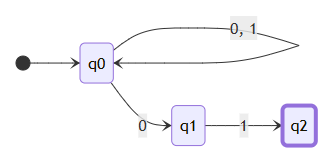
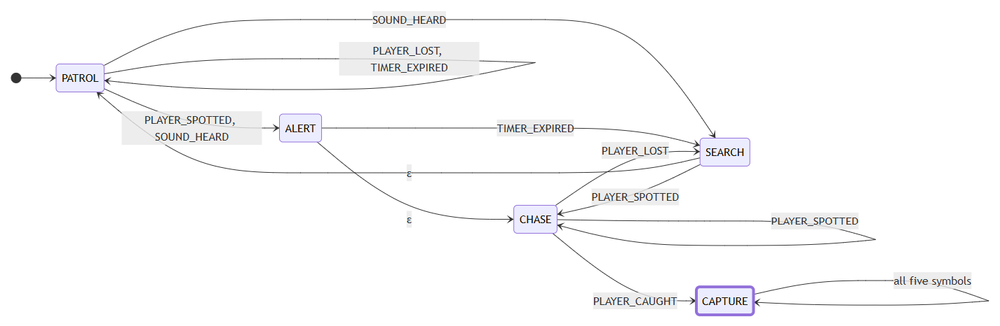
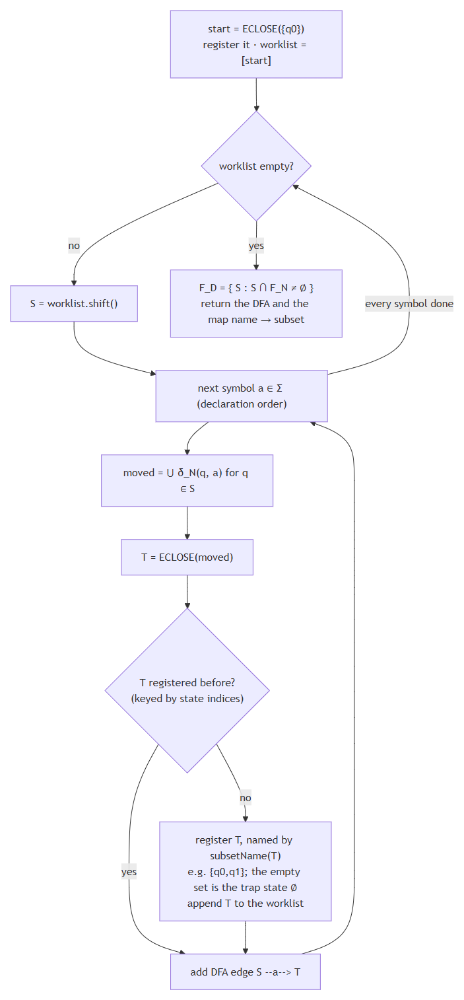
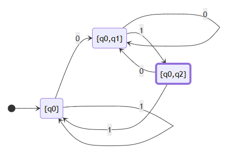
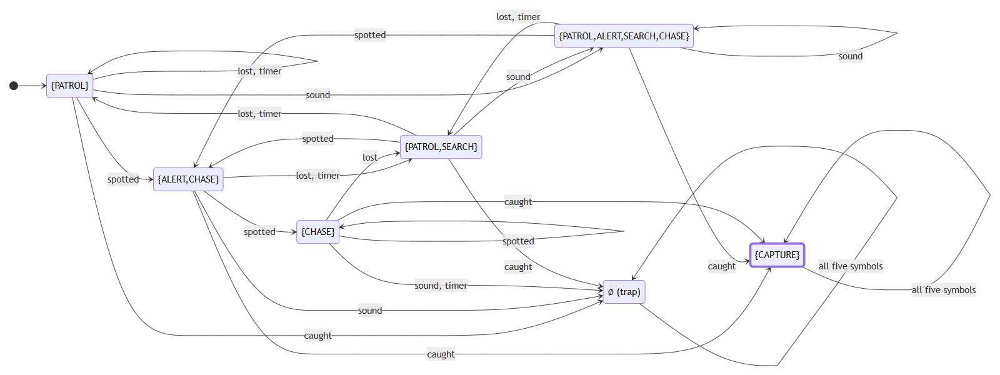
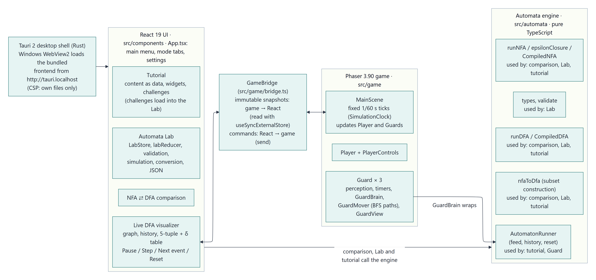
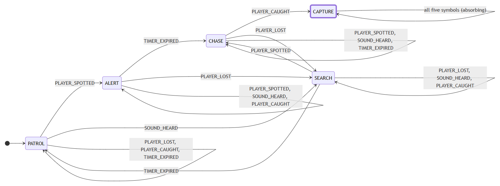
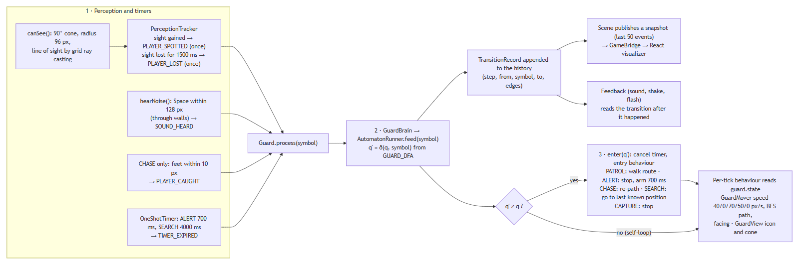
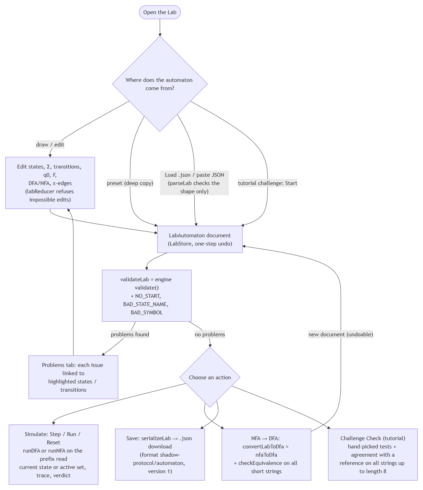

<!--
  Academic project report for Shadow Protocol 1.0.0 (Markdown; mathematics in LaTeX notation, so it can be
  converted with e.g. pandoc later). Every [STUDENT INPUT: ...] marker must be completed by the student.
  Figures are referenced relative to this file: ../diagrams/rendered/*.png (generated from ../diagrams/*.mmd)
  and ../screenshots/*.png (captured from the installed application).
-->

# Shadow Protocol: A Finite Automata-Based Stealth Game and Interactive Learning Environment

**Project report**

| | |
|---|---|
| Course | [STUDENT INPUT: course name and code] |
| Institution | [STUDENT INPUT: school / department, Vellore Institute of Technology (confirm)] |
| Submitted by | [STUDENT INPUT: name(s) and registration number(s) of every team member] |
| Faculty / guide | [STUDENT INPUT: faculty name and designation] |
| Semester / slot | [STUDENT INPUT: e.g. Fall Semester 2026–27, slot] |
| Date of submission | [STUDENT INPUT: date] |
| Software version | Shadow Protocol 1.0.0 (Windows x64 desktop application) |

[STUDENT INPUT: add any declaration, certificate or acknowledgement page your institution requires.]

---

## Table of contents

1. Abstract
2. Introduction
3. Problem Statement
4. Project Objectives
5. Scope of the Project
6. Background: Theory of Computation
7. Deterministic Finite Automata
8. Nondeterministic Finite Automata
9. DFA versus NFA
10. NFA-to-DFA Conversion
11. System Architecture
12. Application Modules and Features
13. NPC Behaviour Modelling
14. The Automata Lab
15. Implementation Methodology
16. Algorithms and Pseudocode
17. Testing and Verification
18. Screenshots and Demonstration Examples
19. Challenges and Limitations
20. Future Scope
21. Conclusion
22. References

Appendix A. Project structure and code size
Appendix B. Glossary of symbols

---

## 1. Abstract

Finite automata are usually taught as abstract mathematical objects: five-tuples, transition tables and state diagrams. Students learn to construct them on paper, but rarely see them operate inside a running system. *Shadow Protocol* addresses this gap with a Windows desktop application in which the automata are not illustrations but the actual control mechanism of a game. It is a top-down, pixel-art stealth game in which three guard non-player characters (NPCs) are each controlled by an independent instance of one deterministic finite automaton (DFA). The DFA has five states (PATROL, ALERT, CHASE, SEARCH and CAPTURE) and an input alphabet of five game events (PLAYER_SPOTTED, PLAYER_LOST, SOUND_HEARD, PLAYER_CAUGHT and TIMER_EXPIRED). Continuous perception (vision cones with line of sight, hearing and proximity) and timers are converted into discrete, edge-triggered input symbols, and the DFA alone decides each guard's behaviour state.

Around the game, the application provides a live visualiser that shows the selected guard's state graph, transition history and formal definition while the game runs, with pause, single-step and reset controls on a fixed-tick simulation. A comparison mode runs a nondeterministic finite automaton (NFA) with ε-transitions side by side with the DFA obtained from it by the subset construction. An Automata Lab lets users build, validate, simulate, convert and save their own DFAs and NFAs. An interactive tutorial of seven modules ends with four challenges solved in the Lab.

All automata logic resides in an independent, framework-free TypeScript engine that implements validation, DFA and NFA simulation, ε-closure and the subset construction. The application is built with Tauri 2, React 19, Phaser 3 and TypeScript, and is verified by 527 automated unit tests (including randomised differential tests of the engine) together with scripted end-to-end checks of the running application.

---

## 2. Introduction

The Theory of Computation studies what can be computed and with what resources, beginning with the simplest model of computation: the finite automaton. A finite automaton has a fixed, finite memory (its current state). It reads an input string one symbol at a time and changes state according to a transition function. Despite this simplicity, finite automata underpin lexical analysers, protocol implementations, digital circuit controllers, text search and the state machines used throughout software engineering.

Video games are a natural application. The behaviour of an NPC is commonly described as a set of behaviour states (patrolling, investigating, chasing) with transitions triggered by events, which is a finite-state machine. In typical game code, however, this machine is implicit: it is scattered across conditional statements, it is not validated, and it cannot be inspected while the game runs.

Shadow Protocol makes the machine explicit. Each guard's behaviour is governed by a DFA $M = (Q, \Sigma, \delta, q_0, F)$ that is declared as data, validated by the same engine that checks user-built automata, executed by a general-purpose automaton runner, and drawn live on screen as the game is played. The project combines this game with a set of learning tools: a visualiser, an NFA/DFA comparison, a laboratory for building automata, and a tutorial. The result is a single application that is both a playable stealth game and an environment for learning finite automata.

This report describes the theory the application implements, its architecture and modules, the algorithms used, the way gameplay is modelled with automata, and the testing carried out to establish that the implementation is mathematically correct.

---

## 3. Problem Statement

Students of the Theory of Computation commonly face three difficulties:

1. **Abstraction without application.** DFAs, NFAs and the subset construction are learned as pen-and-paper exercises, with little connection to systems in which they are actually used.
2. **Static representations.** Textbook state diagrams do not show computation as it happens: how the current state (or, for an NFA, the set of active states) evolves symbol by symbol, or why a string is accepted or rejected.
3. **Nondeterminism is easily misunderstood.** It is often interpreted as randomness or guessing, rather than as the simultaneous pursuit of all computation paths, and the equivalence of NFAs and DFAs remains an abstract theorem.

At the same time, game AI is frequently written as ad-hoc conditional logic: the underlying state machine is never stated, validated or made visible.

The problem addressed by this project is therefore: **to design and implement an application in which finite automata are the real, inspectable control mechanism of an interactive system, and to surround it with tools that let a learner observe, build, simulate and convert automata, while guaranteeing that every automaton operation is mathematically correct.**

---

## 4. Project Objectives

1. Implement a **reusable automata engine**, independent of any user-interface or game framework, supporting DFA and NFA definitions, validation, simulation with full traces, ε-closure and NFA-to-DFA conversion by the subset construction.
2. Build a **stealth game** whose guard NPCs are controlled exclusively by a validated DFA, with perception and timing converted into a finite input alphabet of game events.
3. Run **several guards independently**, each with its own instance of the automaton, sharing only the immutable definition.
4. Provide a **live visualiser** that shows the current state, the last transition, the transition history and the formal 5-tuple, with pause, resume, single-step, step-to-next-event and reset on a deterministic fixed-tick simulation.
5. Demonstrate **nondeterminism** with an NFA run side by side with its subset-construction DFA on the same input.
6. Provide an **Automata Lab** in which users create, edit, validate, simulate, convert, save and load their own automata.
7. Provide an **interactive tutorial** that explains the theory using the application's own automata and ends with challenges solved in the Lab.
8. Verify correctness with **automated tests**, including tests that compare the engine against independent reference implementations.
9. Package the application as an **offline Windows desktop installer**.

---

## 5. Scope of the Project

**In scope**

- Deterministic and nondeterministic finite automata (including ε-transitions) over finite alphabets whose symbols may be multi-character names (for example `PLAYER_SPOTTED`).
- Validation of definitions, simulation with traces, ε-closure, and the subset construction restricted to reachable subsets.
- One game level (40 × 22 tiles), one player character and three DFA-controlled guards.
- Live visualisation of the guards' DFAs; an NFA/DFA comparison mode; the Automata Lab; the tutorial with four challenges.
- A Windows x64 desktop application that works offline after installation.

**Out of scope** (see also Section 19)

- Other models of computation (pushdown automata, Turing machines), regular expressions and DFA minimisation.
- NFA-controlled gameplay: the NFA appears in the comparison mode, the Lab and the tutorial, but the guards in the level always run the DFA.
- Formal (proof-producing) equivalence checking: equivalence of user answers is *tested*, not proved.
- Multiple levels, networking, other operating systems.

---

## 6. Background: Theory of Computation

### 6.1 Alphabets, strings and languages

An **alphabet** $\Sigma$ is a finite, non-empty set of symbols. A **string** over $\Sigma$ is a finite sequence of symbols. The **empty string** $\varepsilon$ has length 0, and $|w|$ denotes the length of $w$. $\Sigma^*$ is the set of all strings over $\Sigma$, including $\varepsilon$. A **language** over $\Sigma$ is any subset $L \subseteq \Sigma^*$.

In Shadow Protocol the symbols are often *names* rather than single characters. For example, the guard alphabet is

$$\Sigma = \{\texttt{PLAYER\_SPOTTED},\ \texttt{PLAYER\_LOST},\ \texttt{SOUND\_HEARD},\ \texttt{PLAYER\_CAUGHT},\ \texttt{TIMER\_EXPIRED}\}.$$

The engine therefore represents a string as an **array of symbols**, never as a character string. $\varepsilon$ is used only as a transition label in NFAs; it is never a member of $\Sigma$ and never appears in an input.

### 6.2 Finite automata and regular languages

A finite automaton reads its input from left to right, one symbol per step, using only a finite set of states as memory. At the end of the input it **accepts** or **rejects**. The set of strings it accepts is the language it **recognises**. The languages recognised by finite automata are exactly the **regular languages** (Kleene's theorem), which are also the languages described by regular expressions [1, 2].

### 6.3 Acceptance versus behaviour

A central distinction in this project is between two different uses of the same machine:

- **Formal acceptance.** A DFA accepts a string $w$ if, after reading all of $w$, it is in a state of $F$. This is a property of the *whole input string*, and $L(M)$ is a set of strings.
- **Operational behaviour.** In the game, a guard's *current* state determines what the guard does at that moment (walk, stop, pursue, search). This is a property of the *current configuration*, and it changes with every event.

For the guard DFA, $F = \{\texttt{CAPTURE}\}$. The language $L(M)$ is the set of event histories that end with the player captured. The other four states are operational states: being in PATROL or CHASE is not "rejection" in any behavioural sense; it simply means that the history so far does not end in a capture. The application's interface uses this wording consistently ("F marks accepted strings, not guard behaviour").

---

## 7. Deterministic Finite Automata

### 7.1 Formal definition

A **deterministic finite automaton** is a 5-tuple

$$M = (Q, \Sigma, \delta, q_0, F)$$

where $Q$ is a finite set of states, $\Sigma$ is the input alphabet, $\delta : Q \times \Sigma \to Q$ is the **transition function**, $q_0 \in Q$ is the start state, and $F \subseteq Q$ is the set of accepting states [1, 2].

Because $\delta$ is a *function* defined on all of $Q \times \Sigma$, a DFA is:

- **deterministic**: at most one next state for each (state, symbol) pair; and
- **complete (total)**: at least one next state for each (state, symbol) pair.

### 7.2 Extended transition function and language

The extended transition function $\hat\delta : Q \times \Sigma^* \to Q$ is defined inductively:

$$\hat\delta(q, \varepsilon) = q, \qquad \hat\delta(q, wa) = \delta(\hat\delta(q, w), a) \quad (w \in \Sigma^*,\ a \in \Sigma).$$

The language of $M$ is $L(M) = \{\, w \in \Sigma^* \mid \hat\delta(q_0, w) \in F \,\}$. In particular, $\varepsilon \in L(M)$ if and only if $q_0 \in F$.

### 7.3 Representation in the engine

The engine (`src/automata/`) stores $\delta$ canonically as an **edge list** of triples $(q, a, q')$. This form is convenient for editing and drawing, and a `CompiledDFA` turns it into a lookup table for execution. A DFA is accepted for execution only if validation reports no issues:

- every pair $(q, a) \in Q \times \Sigma$ must have **exactly one** edge (a missing pair is `MISSING_TRANSITION`, a second edge for the same pair is `DUPLICATE_TRANSITION`);
- ε-edges are not allowed (`EPSILON_IN_DFA`);
- every state and symbol used must belong to $Q$ and $\Sigma$, $q_0 \in Q$, $F \subseteq Q$, and $Q$ is non-empty without duplicates.

Incomplete DFAs are never completed silently. Two explicit helpers exist for completion:

- `completeWithSelfLoops` means "ignore the symbol";
- `completeWithTrap` adds a non-accepting trap state.

`runDFA` returns the verdict, the final state $\hat\delta(q_0, w)$ and a trace with exactly one record per input symbol.

### 7.4 Gameplay application

The guard DFA is presented in full in Section 13. Its $\delta$ is written in the source code as a nested record typed `Record<GuardState, Record<GuardSymbol, GuardState>>`. A missing entry is therefore a compile-time error: the DFA is complete *by construction* and is additionally checked by `validateDFA` in the test suite.

---

## 8. Nondeterministic Finite Automata

### 8.1 Formal definition

A **nondeterministic finite automaton with ε-transitions** is a 5-tuple $N = (Q, \Sigma, \delta, q_0, F)$ in which the transition function returns a *set* of states:

$$\delta : Q \times (\Sigma \cup \{\varepsilon\}) \to \mathcal{P}(Q).$$

A pair may have several successors, or none ($\delta(q, a) = \emptyset$), and the automaton may change state on $\varepsilon$ without reading input.

### 8.2 ε-closure

The **ε-closure** of a state $q$, $\mathrm{ECLOSE}(q)$, is the smallest set that contains $q$ and is closed under ε-transitions: if $p \in \mathrm{ECLOSE}(q)$ and $r \in \delta(p, \varepsilon)$, then $r \in \mathrm{ECLOSE}(q)$. For a set, $\mathrm{ECLOSE}(S) = \bigcup_{q \in S} \mathrm{ECLOSE}(q)$. A state is always in its own closure.

The engine computes the closure by depth-first search with a visited set. This terminates even when ε-transitions form cycles (for example $p \xrightarrow{\varepsilon} r \xrightarrow{\varepsilon} p$) or self-loops.

### 8.3 Active-state sets and simulation

An NFA is simulated by tracking the set of **all** states in which some computation path could be, the **active set**:

$$\hat\delta(q_0, \varepsilon) = \mathrm{ECLOSE}(q_0), \qquad \hat\delta(q_0, wa) = \mathrm{ECLOSE}\Big(\bigcup_{p \in \hat\delta(q_0, w)} \delta(p, a)\Big).$$

$N$ accepts $w$ if and only if $\hat\delta(q_0, w) \cap F \neq \emptyset$, that is, if **at least one** computation path ends in an accepting state. If the active set becomes empty, every path has died and the string is rejected, whatever follows.

The engine's `CompiledNFA.step` performs exactly one such step. It records the **move** set $\bigcup_{p} \delta(p, a)$ separately from its ε-closure, so traces can show which states were added by ε-transitions. State sets are always kept in a canonical order (declaration order in $Q$), so that results are deterministic and directly comparable.

### 8.4 Worked example: strings ending in 01

The textbook NFA `ENDS_WITH_01` has $Q = \{q_0, q_1, q_2\}$, $\Sigma = \{0, 1\}$, start $q_0$, $F = \{q_2\}$, and edges $q_0 \xrightarrow{0,1} q_0$, $q_0 \xrightarrow{0} q_1$, $q_1 \xrightarrow{1} q_2$ (Figure 8.1).



*Figure 8.1: NFA for strings over {0, 1} ending in 01 (source: `diagrams/04a-example-nfa-ends-with-01.mmd`).*

The engine's trace for $w = 1001$ is:

| Step | Symbol read | Active set after the step |
|---|---|---|
| 0 | (none) | $\{q_0\}$ |
| 1 | 1 | $\{q_0\}$ |
| 2 | 0 | $\{q_0, q_1\}$ |
| 3 | 0 | $\{q_0, q_1\}$ |
| 4 | 1 | $\{q_0, q_2\}$ |

The final set contains $q_2 \in F$, so $1001$ is accepted.

### 8.5 The demonstration guard NFA

For the comparison mode the project defines a separate "suspicious guard" NFA, `GUARD_NFA` (Figure 8.2). It uses the same alphabet and has three nondeterministic features:

- $\delta(\texttt{PATROL}, \texttt{SOUND\_HEARD}) = \{\texttt{ALERT}, \texttt{SEARCH}\}$: a sound might be an intruder or nothing, and both possibilities are pursued;
- $\texttt{ALERT} \xrightarrow{\varepsilon} \texttt{CHASE}$: an alerted guard may already be chasing;
- $\texttt{SEARCH} \xrightarrow{\varepsilon} \texttt{PATROL}$: a search may be given up silently.

Pairs with no edge (for example $\delta(\texttt{PATROL}, \texttt{PLAYER\_CAUGHT})$) are $\emptyset$. The ε-closures computed by the engine are:

| $q$ | PATROL | ALERT | SEARCH | CHASE | CAPTURE |
|---|---|---|---|---|---|
| $\mathrm{ECLOSE}(q)$ | {PATROL} | {ALERT, CHASE} | {PATROL, SEARCH} | {CHASE} | {CAPTURE} |



*Figure 8.2: The demonstration guard NFA (source: `diagrams/04b-guard-nfa.mmd`). It is used for teaching only; the guards in the level always run the DFA of Section 13.*

Engine trace for $w = \texttt{SOUND\_HEARD} \cdot \texttt{TIMER\_EXPIRED} \cdot \texttt{PLAYER\_SPOTTED} \cdot \texttt{PLAYER\_CAUGHT}$:

| Step | Symbol | Move set $\bigcup \delta(p, a)$ | Active set (after ε-closure) |
|---|---|---|---|
| 0 | (none) | (none) | {PATROL} |
| 1 | SOUND_HEARD | {ALERT, SEARCH} | {PATROL, ALERT, SEARCH, CHASE} |
| 2 | TIMER_EXPIRED | {PATROL, SEARCH} | {PATROL, SEARCH} |
| 3 | PLAYER_SPOTTED | {ALERT, CHASE} | {ALERT, CHASE} |
| 4 | PLAYER_CAUGHT | {CAPTURE} | {CAPTURE} |

The final set meets $F = \{\texttt{CAPTURE}\}$, so the string is accepted.

`GUARD_NFA` and the gameplay `GUARD_DFA` are **different machines with different languages**. For example, $\texttt{SOUND\_HEARD} \cdot \texttt{PLAYER\_CAUGHT}$ is accepted by the NFA (through PATROL → ALERT →ε CHASE → CAPTURE) but rejected by the guard DFA, which goes PATROL → SEARCH and ignores PLAYER_CAUGHT in SEARCH. The equivalence demonstrated in Section 10 is between the NFA and *its own* subset DFA.

---

## 9. DFA versus NFA

| Aspect | DFA | NFA (with ε) |
|---|---|---|
| Transition function | $\delta : Q \times \Sigma \to Q$ | $\delta : Q \times (\Sigma \cup \{\varepsilon\}) \to \mathcal{P}(Q)$ |
| Successors of $(q, a)$ | exactly one | zero, one or many |
| ε-transitions | not allowed | allowed |
| Configuration during a run | one state | a set of states (the active set) |
| Acceptance of $w$ | $\hat\delta(q_0, w) \in F$ | $\hat\delta(q_0, w) \cap F \neq \emptyset$ |
| Simulation cost per symbol | $O(1)$ table lookup | $O(\lvert Q \rvert + \lvert\delta\rvert)$ for the move and closure |
| Typical size | may need up to $2^n$ states | often exponentially smaller |
| Expressive power | regular languages | the same: regular languages |

**Nondeterminism is not randomness.** An NFA does not choose a path by chance or with a probability. Its acceptance condition quantifies over *all* computation paths ("there exists a path that ends in $F$"). The simulation follows them all at once by tracking the active set, and it is entirely deterministic: the same NFA and input always give the same active sets and the same verdict. The comparison mode and the tutorial state this explicitly.

**Equal expressive power.** Every DFA is trivially an NFA. Conversely, by the theorem of Rabin and Scott [3], for every NFA $N$ there is a DFA $D$ with $L(D) = L(N)$, constructed by the subset construction of Section 10. The price is size. The NFA "the third symbol from the end is 1" (`THIRD_FROM_END_IS_1`) has 4 states, while its smallest DFA has $2^3 = 8$ states. The project's test suite proves this minimality with the Myhill–Nerode argument: all 8 reachable states of the subset DFA are pairwise distinguishable (Section 17).

---

## 10. NFA-to-DFA Conversion

### 10.1 The subset construction

Given an NFA $N = (Q_N, \Sigma, \delta_N, q_0, F_N)$, the subset construction defines $D = (Q_D, \Sigma, \delta_D, S_0, F_D)$ by

$$S_0 = \mathrm{ECLOSE}(q_0), \qquad \delta_D(S, a) = \mathrm{ECLOSE}\Big(\bigcup_{q \in S} \delta_N(q, a)\Big), \qquad F_D = \{\, S \in Q_D \mid S \cap F_N \neq \emptyset \,\},$$

where $Q_D \subseteq \mathcal{P}(Q_N)$ is the set of subsets reachable from $S_0$. The empty set, when reachable, is a non-accepting **trap state** $\emptyset$ with $\delta_D(\emptyset, a) = \emptyset$ for all $a$. It keeps $\delta_D$ total, so the result is always a complete DFA.

### 10.2 Correctness (standard proof sketch)

**Claim.** For every $w \in \Sigma^*$, $\hat\delta_D(S_0, w) = \hat\delta_N(q_0, w)$.

*Proof by induction on $|w|$.*

- **Basis.** $\hat\delta_D(S_0, \varepsilon) = S_0 = \mathrm{ECLOSE}(q_0) = \hat\delta_N(q_0, \varepsilon)$.
- **Step.** Let $w = xa$ and assume $\hat\delta_D(S_0, x) = \hat\delta_N(q_0, x) = S$. Then $\hat\delta_D(S_0, xa) = \delta_D(S, a) = \mathrm{ECLOSE}\big(\bigcup_{q \in S}\delta_N(q, a)\big) = \hat\delta_N(q_0, xa)$.

Hence $w \in L(D) \iff \hat\delta_D(S_0, w) \in F_D \iff \hat\delta_N(q_0, w) \cap F_N \neq \emptyset \iff w \in L(N)$. $\square$

This is the textbook argument [1, §2.3.5 and §2.5.5]. The implementation does not rely on it alone: the invariant "the DFA state reached equals the NFA's active set" is checked at run time by the comparison mode after every step, and by the tests on every string up to length 6 for 250 random ε-NFAs (Section 17).

### 10.3 Implementation

`nfaToDfa` (`src/automata/subsetConstruction.ts`) builds only reachable subsets, using a FIFO worklist (Figure 10.1):

- subsets are identified internally by the list of their states' *indices* in $Q_N$, so the identity is unambiguous whatever characters the state names contain;
- each new subset is named by `subsetName`, in textbook style (`{q0,q1}`, or `∅` for the empty set). State names that could make the naming ambiguous (containing `,` `{` `}` `"` `\` or `∅`, or empty) are quoted as JSON strings. The naming is therefore *injective*: different subsets always get different DFA state names, a property tested on all $2^{12}$ subsets of a set of deliberately awkward names;
- the result also returns the map from each DFA state name to the subset it represents.



*Figure 10.1: The subset construction as implemented (source: `diagrams/05a-subset-construction-algorithm.mmd`).*

### 10.4 Worked example 1: strings ending in 01

Applying the construction to `ENDS_WITH_01` (Section 8.4):

| DFA state | Stands for | on 0 | on 1 | Accepting? |
|---|---|---|---|---|
| → $A$ | {q0} | $B$ | $A$ | no |
| $B$ | {q0, q1} | $B$ | $C$ | no |
| $C$ | {q0, q2} | $B$ | $A$ | **yes** ($q_2 \in F_N$) |

Derivation of the first rows:

- $S_0 = \mathrm{ECLOSE}(q_0) = \{q_0\}$, because there are no ε-edges.
- $\delta_D(\{q_0\}, 0) = \delta_N(q_0, 0) = \{q_0, q_1\}$, which is new.
- $\delta_D(\{q_0\}, 1) = \{q_0\}$.
- $\delta_D(\{q_0, q_1\}, 1) = \delta_N(q_0, 1) \cup \delta_N(q_1, 1) = \{q_0\} \cup \{q_2\} = \{q_0, q_2\}$, which is new.

The worklist empties after three subsets: only 3 of the $2^3 = 8$ possible subsets are reachable (Figure 10.2). This is the same 3-state DFA as the textbook one, and the engine's tests check that it accepts exactly the strings ending in 01 among all strings up to length 8.



*Figure 10.2: The subset DFA for `ENDS_WITH_01` (source: `diagrams/05b-subset-dfa-ends-with-01.mmd`).*

### 10.5 Worked example 2: the guard NFA

For `GUARD_NFA` the engine finds 7 reachable subsets out of $2^5 = 32$:

- $S_0 = \{\texttt{PATROL}\}$;
- $\{\texttt{ALERT}, \texttt{CHASE}\}$;
- $\{\texttt{PATROL}, \texttt{ALERT}, \texttt{SEARCH}, \texttt{CHASE}\}$;
- $\{\texttt{CHASE}\}$;
- $\{\texttt{PATROL}, \texttt{SEARCH}\}$;
- $\{\texttt{CAPTURE}\}$;
- the trap state $\emptyset$.

The only accepting state is $\{\texttt{CAPTURE}\}$. The complete transition table, printed by the engine (columns abbreviated: spotted, lost, sound, caught, timer):

| DFA state | spotted | lost | sound | caught | timer |
|---|---|---|---|---|---|
| → {PATROL} | {ALERT,CHASE} | {PATROL} | {PATROL,ALERT,SEARCH,CHASE} | ∅ | {PATROL} |
| {ALERT,CHASE} | {CHASE} | {PATROL,SEARCH} | ∅ | {CAPTURE} | {PATROL,SEARCH} |
| {PATROL,ALERT,SEARCH,CHASE} | {ALERT,CHASE} | {PATROL,SEARCH} | {PATROL,ALERT,SEARCH,CHASE} | {CAPTURE} | {PATROL,SEARCH} |
| ∅ | ∅ | ∅ | ∅ | ∅ | ∅ |
| {CHASE} | {CHASE} | {PATROL,SEARCH} | ∅ | {CAPTURE} | ∅ |
| {PATROL,SEARCH} | {ALERT,CHASE} | {PATROL} | {PATROL,ALERT,SEARCH,CHASE} | ∅ | {PATROL} |
| \* {CAPTURE} | {CAPTURE} | {CAPTURE} | {CAPTURE} | {CAPTURE} | {CAPTURE} |

Two derivations show the role of ε-closure:

- $\delta_D(\{\texttt{PATROL}\}, \texttt{SOUND\_HEARD}) = \mathrm{ECLOSE}(\{\texttt{ALERT}, \texttt{SEARCH}\}) = \{\texttt{PATROL}, \texttt{ALERT}, \texttt{SEARCH}, \texttt{CHASE}\}$. The closure adds CHASE (from ALERT) and PATROL (from SEARCH).
- $\delta_D(\{\texttt{ALERT}, \texttt{CHASE}\}, \texttt{TIMER\_EXPIRED}) = \mathrm{ECLOSE}(\{\texttt{SEARCH}\}) = \{\texttt{PATROL}, \texttt{SEARCH}\}$, because $\delta_N(\texttt{CHASE}, \texttt{TIMER\_EXPIRED}) = \emptyset$.



*Figure 10.3: The subset DFA of the guard NFA (source: `diagrams/05c-subset-dfa-guard-nfa.mmd`).*

---

## 11. System Architecture

### 11.1 Technology stack

The versions below are those resolved in the project at the time of writing.

| Layer | Technology | Version | Role |
|---|---|---|---|
| Desktop shell | Tauri (Rust) | 2.12.4 (CLI 2.12.3), Rust 1.99.1 | Native window, packaging; renders the UI in the Windows WebView2 runtime |
| UI | React with TypeScript | React 19.3.1, TypeScript 6.0.3 | Menus, visualiser, comparison, Lab, tutorial |
| Game engine | Phaser | 3.90.0 (pinned) | Tilemap rendering, Arcade physics, sprites, input |
| Build | Vite | 8.3.4 | Development server and production bundle |
| Tests | Vitest | 5.0.5 | Unit and property tests in Node |
| Installers | NSIS and WiX (via Tauri bundler) | — | `.exe` (per-user) and `.msi` installers |

There are no other runtime dependencies. All pixel art and sound effects are generated in code (canvas drawing and the Web Audio API); the application loads no image or audio files and needs no network connection.

### 11.2 Layered design

The code is organised in three layers with a strict dependency direction: `components → game → automata` (Figure 11.1).

- **`src/automata/`, the automata engine.** Pure TypeScript with no dependency on React, Phaser or the browser. A test (`boundary.test.ts`) fails if any file in this folder imports anything outside it. The engine is shared by the game, the visualiser, the comparison mode, the Lab and the tutorial, so there is exactly one implementation of every automaton operation.
- **`src/game/`, the Phaser game.** The level, player, guards, perception and pathfinding. It never imports React. Pure logic (level parsing, geometry, perception, pathfinding, timers, the simulation clock, snapshots) is kept out of Phaser classes so that it can be tested in Node.
- **`src/components/`, the React UI.** It never imports Phaser and never touches game objects.



*Figure 11.1: System architecture (source: `diagrams/01-system-architecture.mmd`).*

### 11.3 React–Phaser communication

React and Phaser communicate only through a `GameBridge` object.

- **Game → React.** The scene publishes an **immutable snapshot**: run id, pause state, tick count, selected guard, and per-guard state, accepting flag and the last 50 transitions. It publishes only when something changed. React components subscribe with `useSyncExternalStore` and select the slice they display. A guard's snapshot object is reused while that guard has processed no new events, so the visualiser does not re-render for other guards' events.
- **React → game.** The UI sends **commands** (`pause`, `resume`, `step`, `stepToEvent`, `reset`, `selectGuard`, `setKeyboardEnabled`, `setDisplayOptions`), which the scene drains at the start of each frame.

### 11.4 Deterministic fixed-tick simulation

All game logic runs in fixed ticks of 1/60 s (`SimulationClock`). Each tick runs in a fixed order:

1. player input;
2. noise;
3. every guard's `tick()`, in a fixed guard order;
4. one physics step (Arcade Physics runs with `customUpdate`, so it never steps on its own).

Timers are measured in ticks, not wall-clock time. As a result:

- **Pause** means zero ticks.
- **Step** means exactly one tick.
- **Next event** runs ticks until some guard's history grows, capped at 30 simulated seconds.
- **Reset** restarts the level with fresh automaton runs.

Rendering, sound and screen effects only *read* the state after a tick; they never feed events or move bodies.

---

## 12. Application Modules and Features

| Module | Location | Features |
|---|---|---|
| Main menu and settings | `App.tsx`, `MainMenu.tsx`, `SettingsDialog.tsx` | Play, Tutorial, NFA ⇄ DFA, Automata Lab, Settings, Exit; settings for sound, volume, vision cones and animations (stored locally). The game is paused and its keys disabled whenever it is out of sight. |
| Stealth game | `src/game/` | One 40 × 22-tile level; WASD/arrow movement with normalised diagonals and tilemap collision; Space makes a noise (800 ms cooldown); R restarts; three guards with their own patrol routes, colours and numbers; vision cones with line of sight; player status HUD (HIDDEN, UNDER SEARCH, SPOTTED, CHASED, CAUGHT). |
| Live DFA visualiser | `components/visualizer/` | Generic over any DFA or NFA: the state graph (current state, last transition, inspected edge, dashed ε-edges), transition history with inspection, formal definition ($Q, \Sigma, q_0, F, w$ and the δ table), and simulation controls. Selecting a guard (click or HUD chip) switches the visualiser to it. |
| NFA ⇄ DFA comparison | `components/comparison/` | An input tape with step, play, pause, reset and example inputs; the guard NFA and its subset DFA drawn side by side; active set vs. DFA state with the subset invariant checked; verdicts; traces (move and ε-closure); subset table; both formal definitions. |
| Automata Lab | `components/lab/` | See Section 14. |
| Tutorial | `components/tutorial/` | Seven modules (18 pages) with interactive widgets and four challenges (Section 12.1). |

### 12.1 Tutorial

The tutorial content is stored as data (`content/modules.ts`) and rendered by generic widgets that call the engine. The modules and their pages are:

1. **Finite automata**: what a finite automaton is; behaviour states vs. accepting states.
2. **Deterministic finite automata**: guard events driving deterministic transitions; a textbook DFA.
3. **Nondeterministic finite automata**: several possible next states; ε-transitions and ε-closure; a nondeterministic guard.
4. **DFA vs. NFA**: same input, two machines; equal power, no randomness.
5. **NFA → DFA conversion**: the subset construction step by step; converting the guard NFA.
6. **Automata in game AI**: from perception to symbols to behaviour; what the automaton does and does not do.
7. **Interactive challenges**: how the challenges work; Challenges 1–4.

The widgets are:

- a state graph, a formal definition, and steppers that run examples symbol by symbol;
- an ε-closure explorer;
- the NFA/DFA comparison;
- a row-by-row subset construction;
- a "perception → DFA → behaviour" pipeline that drives its own automaton runner, never the game's guards.

Every example's stated result (verdict and final state or set) is re-checked against the engine by the test suite. Progress (current page, visited pages, solved challenges) is saved locally.

**Challenges**

| # | Title | Difficulty | Required | Σ | Task (summary) | Hand-picked tests (rejecting) |
|---|---|---|---|---|---|---|
| 1 | Ends in 01 | Easy | DFA | {0, 1} | accept binary strings ending in 01 | 10 (6) |
| 2 | Raise the alarm | Easy | DFA | {PLAYER_SPOTTED, PLAYER_LOST} | two consecutive PLAYER_SPOTTED events | 7 (4) |
| 3 | Find the pattern | Medium | DFA | {a, b} | strings containing aba | 9 (5) |
| 4 | Guess the end | Hard | DFA or NFA, ≤ 3 states | {0, 1} | the second-to-last symbol is 1 | 9 (5) |

Challenge 4 cannot be solved with a DFA, since the smallest DFA has 4 states (proved by the tests, Section 17), so it requires an NFA.

A challenge is started from the tutorial, which loads an empty starter document into the Lab; the user builds the automaton there. **Checking is testing, not proof.** The answer must:

1. be valid;
2. be of the required kind, with Σ exactly as specified and within the state limit;
3. pass the hand-picked tests;
4. agree with a reference automaton on **every string up to length 8** (511 strings for a binary alphabet).

The report shown to the user states that this is strong evidence, not a proof that the languages are equal.

---

## 13. NPC Behaviour Modelling

### 13.1 The guard DFA

Every guard runs the same DFA $M_G = (Q, \Sigma, \delta, q_0, F)$, defined in `src/game/guard/guardDfa.ts`:

- $Q = \{\texttt{PATROL}, \texttt{ALERT}, \texttt{CHASE}, \texttt{SEARCH}, \texttt{CAPTURE}\}$
- $\Sigma = \{\texttt{PLAYER\_SPOTTED}, \texttt{PLAYER\_LOST}, \texttt{SOUND\_HEARD}, \texttt{PLAYER\_CAUGHT}, \texttt{TIMER\_EXPIRED}\}$
- $q_0 = \texttt{PATROL}$, $F = \{\texttt{CAPTURE}\}$

The transition table (all 25 entries; entries in *italics* are self-loops, meaning the event is ignored in that state):

| δ | PLAYER_SPOTTED | PLAYER_LOST | SOUND_HEARD | PLAYER_CAUGHT | TIMER_EXPIRED |
|---|---|---|---|---|---|
| → PATROL | ALERT | *PATROL* | SEARCH | *PATROL* | *PATROL* |
| ALERT | *ALERT* | SEARCH | *ALERT* | *ALERT* | CHASE |
| CHASE | *CHASE* | SEARCH | *CHASE* | CAPTURE | *CHASE* |
| SEARCH | CHASE | *SEARCH* | *SEARCH* | *SEARCH* | PATROL |
| \* CAPTURE | *CAPTURE* | *CAPTURE* | *CAPTURE* | *CAPTURE* | *CAPTURE* |



*Figure 13.1: The guard DFA (source: `diagrams/03-guard-dfa.mmd`).*

The definition is **deep-frozen** at run time, and all three guards share it. Each guard owns its own `AutomatonRunner` (through `GuardBrain`), which is the only source of that guard's state. There is no parallel conditional state machine: behaviour code reads `guard.state`.

Because CAPTURE is absorbing and is the only accepting state, $w \in L(M_G)$ if and only if some prefix of $w$ drives $M_G$ into CAPTURE. Once captured, the history stays in $L(M_G)$. In the game, the capture also freezes the player, and the capturing guard stops perceiving, so its history ends there.

### 13.2 Operational meaning of the states

| State | Meaning | Speed (px/s) | Entry behaviour | Per-tick behaviour |
|---|---|---|---|---|
| PATROL | walk the patrol route | 40 | head for the next waypoint | advance waypoints in a loop |
| ALERT | just spotted the player ("!") | 0 | stop; arm a 700 ms timer | face the player |
| CHASE | pursue the last known position | 70 | re-path immediately | re-path every 250 ms; capture check |
| SEARCH | go to where the player was last seen or heard ("?") | 50 | walk to the last known position | on arrival, look around for 4000 ms |
| CAPTURE | the player is caught | 0 | stop | (absorbing) |

The player moves at 80 px/s, faster than a chasing guard (70 px/s), so escape is possible. Entering a state always cancels the previous state's timer. In SEARCH, a new SOUND_HEARD is a self-loop of the DFA but re-runs the entry behaviour, so the guard goes to investigate the new sound.

### 13.3 From gameplay to input symbols

The game world is continuous (positions, angles, time), but the DFA reads discrete symbols. `Guard.tick()` converts one into the other in a fixed order each tick: perception, then state behaviour including the capture check, then the timer (Figure 13.2). Every symbol is **edge-triggered**: it is produced once per change, never once per frame.

| Symbol | Produced by | Condition |
|---|---|---|
| PLAYER_SPOTTED | `PerceptionTracker` | on the tick that sight is gained: the player is within 96 px, inside the 90° cone and in line of sight (grid ray casting; walls block sight) |
| PLAYER_LOST | `PerceptionTracker` | after sight has been lost continuously for 1500 ms (a brief occlusion produces no events) |
| SOUND_HEARD | `hearNoise` | the player presses Space within 128 px of the guard (walls do not block hearing) |
| PLAYER_CAUGHT | capture check | only in CHASE: the guard's feet are within 10 px of the player's feet |
| TIMER_EXPIRED | `OneShotTimer` | the timer armed by ALERT (700 ms) or by SEARCH's look-around (4000 ms) runs out |

`Guard.process(symbol)` is the only place symbols are fed to the automaton. It calls the runner, receives a transition record, and runs the entry behaviour of the new state if the state changed. Movement uses 8-directional breadth-first search on the tile grid without corner cutting. Movement, collision, pathfinding, animation and sound are deliberately **outside** the automaton. They implement *how* a state is carried out; the DFA decides *which* state the guard is in.



*Figure 13.2: From game events to DFA transitions to guard behaviour (source: `diagrams/02-event-to-behaviour-workflow.mmd`).*

### 13.4 Execution examples

The traces below are produced by `runDFA(GUARD_DFA, w)`:

| Input $w$ | Run | Final state | $w \in L(M_G)$? |
|---|---|---|---|
| $\varepsilon$ | (no steps) | PATROL | no ($q_0 \notin F$) |
| SPOTTED · TIMER · CAUGHT | PATROL → ALERT → CHASE → CAPTURE | CAPTURE | **yes** |
| SOUND · TIMER | PATROL → SEARCH → PATROL | PATROL | no |
| SPOTTED · LOST · TIMER | PATROL → ALERT → SEARCH → PATROL | PATROL | no |
| SPOTTED · TIMER · LOST · SPOTTED | PATROL → ALERT → CHASE → SEARCH → CHASE | CHASE | no |

The second row corresponds to a typical capture in the game:

1. the guard sees the player and stops ("!");
2. after the 700 ms reaction time it starts chasing;
3. it reaches the player.

Screenshot 2 (Section 18) shows this exact history recorded live in the installed application.

The last row shows why "rejected" must not be read behaviourally. The guard is actively chasing, but the history does not (yet) end in a capture.

### 13.5 Independent guards

Three guards (G1–G3) share only the immutable DFA and the tuning constants. Each has its own runner, perception tracker, timer, mover, facing and last known position. Every tick updates them in a fixed order, so runs are deterministic. A noise is offered to every guard, and each decides by its own hearing radius. When any guard reaches CAPTURE the player is frozen, while the other guards keep running their own automata. Selecting a guard (by clicking it or its HUD chip) only changes what the visualiser shows.

---

## 14. The Automata Lab

### 14.1 Editor

The Lab edits a `LabAutomaton` document:

- a name and a kind (DFA or NFA);
- the alphabet;
- states with **stable identifiers** (`s1`, `s2`, …) and positions;
- transitions referring to state identifiers;
- a start state and a set of accepting states.

Names are display data only: renaming a state never breaks a transition. The editor supports:

- adding, renaming, moving and deleting states (deleting a state also removes its transitions);
- adding and removing symbols and transitions, including ε-transitions in NFA mode;
- choosing $q_0$ and $F$;
- switching between DFA and NFA;
- a one-step undo for whole-document changes.

The interactive graph supports selection, dragging and drawing transitions by connecting states. All edits go through a reducer that refuses edits that could never be meaningful: a duplicate state name, ε in Σ, a transition to a missing state, or a symbol with a space or comma, which could never be typed as input. A second target for the same pair in DFA mode *is* allowed, so that validation can show the nondeterminism to the user.

### 14.2 Validation

Validation is always the engine's own `validate()`; the Lab maps each issue to the states and transitions involved and highlights them in the graph. Three checks are added that only matter for documents loaded from a file:

- `NO_START`: no start state chosen;
- `BAD_STATE_NAME`: an empty name or the name "ε";
- `BAD_SYMBOL`: a symbol that cannot be typed as input.

Simulation is only possible when validation reports no problems.

### 14.3 Simulation

The input is typed as text: single-character alphabets are split into characters, other alphabets on spaces or commas, and an empty input means ε. The simulator offers Step, Run, Reset and Clear, and shows:

- the current state (DFA) or active set (NFA, including ε-closure), highlighted on the graph together with the edges just taken;
- a trace table;
- the verdict ($w \in L(M)$ or $w \notin L(M)$).

Each step re-runs the engine on the prefix read so far, so the display always equals the engine's result.

### 14.4 Conversion

For a valid NFA, **Convert to DFA** calls `nfaToDfa` and replaces the document with the resulting DFA, whose states are named by their subsets. This is undoable, and "back to the NFA" is available. The panel shows the subset table and the result of `checkEquivalence`, which compares the two automata on **every** string up to the longest length whose strings fit within 5,000. The panel words this as a check, and notes that equal languages are guaranteed by the subset construction theorem.

### 14.5 Presets and persistence

Nine presets are available, each loaded as a deep copy:

- the guard DFA and the guard NFA;
- even number of a's; even number of 0s;
- ends with ab; binary numbers divisible by 3;
- ends with 01 (NFA); third from the end is 1 (NFA);
- $a^* \cup b^*$ (ε-NFA).

Documents are saved as JSON (format `shadow-protocol/automaton`, version 1). The file includes positions and identifiers, and ε-transitions use the symbol "ε". Loading checks only the *shape* of the file and refuses malformed files with a reason. Well-formed files that describe an invalid automaton are loaded, and their problems are shown by validation. Saving uses a download into the Downloads folder.



*Figure 14.1: Automata Lab workflow (source: `diagrams/06-automata-lab-workflow.mmd`).*

---

## 15. Implementation Methodology

The project was developed **incrementally in milestones**, each ending with automated tests, a type check, a production build and a check inside the desktop application before the next one began:

| Milestone | Content |
|---|---|
| 1 | Project setup: Tauri + React + TypeScript + Phaser + Vitest; static tile scene |
| 2 | Automata engine: types, validation, DFA/NFA simulation, ε-closure, subset construction, completion helpers, runner with history; unit tests (no game integration yet) |
| 3A / 3B | Player movement and collision; one DFA-controlled guard with vision, noise, pathfinding and HUD |
| 4 | Live DFA visualiser with a fixed-tick simulation (pause, step, next event, reset) |
| 5A / 5B | Three independent guards with selection; the NFA ⇄ DFA comparison mode |
| 6A / 6B | Automata Lab: editor and validation; simulation, conversion, presets, JSON, undo |
| 7A / 7B | Visual polish (animated sprites, icons, sound, menu, settings); the interactive tutorial |
| 7C.1 / 7C.2 | Comprehensive testing and bug fixing; Windows packaging |

The guiding design principles were:

1. **One source of truth for the mathematics.** Every simulation, conversion and check, in the game, the visualiser, the comparison, the Lab and the tutorial, calls the same engine. No component re-implements automaton logic.
2. **Automata as data.** δ is an edge list; definitions are validated, never silently repaired; incomplete DFAs are errors, not defaults.
3. **Pure logic out of the frameworks.** Everything that can be tested without a browser lives in plain TypeScript modules (engine, level parser, geometry, perception, pathfinding, timers, clock, snapshots, Lab model, tutorial content).
4. **Determinism.** Fixed ticks, a fixed update order, canonical state-set ordering and edge-triggered events make every run reproducible, so single-stepping is meaningful.
5. **Separation of decision and execution.** The DFA decides the behaviour state; movement, perception, rendering and sound carry it out, and the visual layer only reads state.

---

## 16. Algorithms and Pseudocode

### 16.1 DFA simulation (`runDFA`)

```
runDFA(M, w):
    validate M (complete and deterministic) and w (every symbol in Σ)
    q ← q0;  trace ← []
    for i ← 1 to |w|:
        q' ← δ(q, w[i])                      // table lookup
        append (i, q, w[i], q') to trace
        q ← q'
    return (accepted: q ∈ F, finalState: q, trace)
```

Time $O(|w|)$ after an $O(|Q|\,|\Sigma|)$ compilation of the edge list into a table.

### 16.2 ε-closure (`CompiledNFA.closure`)

```
ECLOSE(S):
    stack ← S;  visited ← S
    while stack not empty:
        p ← pop(stack)
        for each edge (p, ε, r):
            if r ∉ visited: add r to visited; push r
    return visited in declaration order of Q
```

Each state is pushed at most once, so the time is $O(|Q| + |\delta_\varepsilon|)$, and ε-cycles terminate.

### 16.3 NFA simulation (`runNFA`)

```
runNFA(N, w):
    validate N and w
    S ← ECLOSE({q0});  trace ← []
    for i ← 1 to |w|:
        moved ← ⋃ { δ(p, w[i]) : p ∈ S }
        S'    ← ECLOSE(moved)
        append (i, S, w[i], moved, S') to trace
        S ← S'
    return (accepted: S ∩ F ≠ ∅, finalStates: S, trace)
```

Time $O(|w| \cdot (|Q| + |\delta|))$ per input string; space $O(|Q|)$ for the active set.

### 16.4 Subset construction (`nfaToDfa`)

```
nfaToDfa(N):
    S0 ← ECLOSE({q0});  register(S0);  worklist ← [S0]
    while worklist not empty:
        S ← dequeue(worklist)
        for each a ∈ Σ:
            T ← ECLOSE(⋃ { δ(p, a) : p ∈ S })
            if T not registered: register(T); enqueue(worklist, T)
            add edge (S, a, T)
    F_D ← { S registered : S ∩ F ≠ ∅ }
    return DFA(registered sets, Σ, edges, S0, F_D) and the name → set map
```

At most $2^{|Q|}$ subsets can be registered, so the worst-case time is $O(2^{|Q|} \cdot |\Sigma| \cdot (|Q| + |\delta|))$. Building only reachable subsets usually gives far fewer: 3 of 8 for `ENDS_WITH_01` and 7 of 32 for the guard NFA. The bound is reached up to small factors by `THIRD_FROM_END_IS_1` (8 states from 4).

### 16.5 Edge-triggered perception (`PerceptionTracker.update`)

```
update(visible, Δt):
    if visible:
        unseen ← 0
        if not aware: aware ← true; return PLAYER_SPOTTED
        return none
    if not aware: return none
    unseen ← unseen + Δt
    if unseen < LOST_DELAY (1500 ms): return none
    aware ← false; unseen ← 0; return PLAYER_LOST
```

### 16.6 Guard tick and event processing (`Guard.tick`, `Guard.process`)

```
tick(Δt, player):
    if state ≠ CAPTURE:
        perceive(player)            // may process PLAYER_SPOTTED / PLAYER_LOST
        act(Δt, player)             // state behaviour; in CHASE may process PLAYER_CAUGHT
        if timer.update(Δt): process(TIMER_EXPIRED)
    mover.update(); updateFacing(Δt)

process(a):
    (q, q') ← runner.feed(a)        // the only call into the automaton
    if q' ≠ q: enter(q')            // cancel timer, run q''s entry behaviour
```

### 16.7 Equivalence check by testing (`checkEquivalence`)

```
checkEquivalence(A, B, budget):
    for length ← 0, 1, 2, ... while all strings of this length fit in the budget:
        for each w ∈ Σ^length (in order):
            if accepts(A, w) ≠ accepts(B, w): return (false, counterexample w)
    return (true, number tested, maximum length)
```

Because the strings are enumerated in order of length, a counterexample found is a *shortest* one. Agreement up to a fixed length is evidence, not proof. Proof would need, for example, a length bound depending on the sizes of both automata (see Section 20).

---

## 17. Testing and Verification

### 17.1 Automated unit tests

The test suite uses Vitest and runs in Node. At the time of writing it contains **527 tests in 41 files, all passing**.

| Area | Tests | What is covered |
|---|---|---|
| Automata engine (`src/automata/`) | 132 | Validation of every issue type; DFA runs, traces, multi-character symbols, invalid input; completion helpers; ε-closure (incl. ε-cycles and self-loops); NFA runs incl. ε, dead branches and empty-set rejection; the runner (history, reset, replay, immutability); the subset construction (validity, language equivalence, the subset invariant, determinism, textbook results, injective naming with awkward state names); the engine's import boundary; randomised differential tests |
| Game logic (`src/game/`) | 175 | The guard DFA (completeness via `validateDFA`, every transition), the guard NFA, perception (ray casting, field of view, line of sight), edge-triggered events, pathfinding (8-direction BFS, no corner cutting), the simulation clock (pause, step, tick rounding), level parsing and tile mapping, decorations, movement, multiple guards, bridge and snapshots, sound configuration |
| UI logic (`src/components/`) | 220 | Lab model, validation, JSON (round trips, 12 malformed-file cases, files that break editor rules), simulation, conversion and equivalence, presets, geometry, store; comparison model; input tape; tutorial content, markup, progress, subset steps and challenges; visualiser layout; settings; player status |

**Engine differential tests** (`randomized.test.ts`): 250 random ε-NFAs are generated from a fixed seed, so every run checks the same machines. They have 1–5 states, alphabets of 0–2 symbols, random ε-edges (including cycles and self-loops) and random accepting sets. For every string up to length 6:

- `runNFA`'s final active set and verdict equal those of an **independent brute-force search over computation paths** (written without the engine's ε-closure);
- the empty string is accepted iff $\mathrm{ECLOSE}(q_0) \cap F \neq \emptyset$;
- traces record exactly the symbols read, chained from state to state;
- `nfaToDfa` yields a valid DFA with the same verdict on every string, and the DFA state reached is exactly the NFA's active set;
- the step-by-step runner agrees with `runNFA`.

A further test confirms that the random sample actually contains ε-cycles, empty alphabets, empty accepting sets and reachable trap states.

**Checks of the tutorial's mathematical claims** (`content.test.ts`):

- every example's stated verdict and final state or set is re-computed with the engine;
- the guard NFA gives 7 DFA states;
- two minimality claims are **proved** with the Myhill–Nerode argument. If every pair of states of the reachable subset DFA is distinguished by some suffix, no smaller DFA exists. This confirms that "the third symbol from the end is 1" needs 8 states and "the second-to-last symbol is 1" (Challenge 4) needs 4.

**Challenge checker tests:** correct answers pass, including equivalent ones built differently (an extra redundant state; an NFA with an ε-transition). Wrong answers fail with a shortest counterexample, including a machine that is wrong only on a string not among the hand-picked tests. Invalid documents, the wrong kind, the wrong Σ and too many states are reported.

### 17.2 Static checks and builds

- TypeScript type check (`tsc`): no errors.
- Vite production build: succeeds. The only warning is the expected one about the size of the bundle, which contains Phaser.
- Rust: `cargo clippy` reports no warnings. The release build produced both installers: `Shadow Protocol_1.0.0_x64-setup.exe` (3,498,118 bytes) and `Shadow Protocol_1.0.0_x64_en-US.msi` (4,255,744 bytes).

### 17.3 End-to-end checks of the running application

During development the running desktop application was driven through the WebView2 DevTools protocol by scripted checks. These scripts simulate real mouse and keyboard input and read the application's state. They are development tools kept outside the repository [STUDENT INPUT: include them in the submission if required]. The results of the final runs:

| Suite | Checks passed | Examples of what is checked |
|---|---|---|
| Movement | 20 / 20 | key handling, diagonals, wall collision, focus loss |
| Multiple guards | 41 / 41 | independent DFAs, selection, capture freezing, status HUD |
| Visualiser | 39 / 39 | graph highlighting, history, formal definition, pause/step/reset |
| Comparison | 54 / 54 | subset invariant after every step, verdicts, traces |
| Lab (editor) | 34 / 34 | creating, renaming, moving, deleting; validation highlights |
| Lab (simulation, conversion, files) | 34 / 34 | simulation, conversion, JSON save and load, malformed files |
| Visual polish and menu | 31 / 31 | menu, settings, pausing out of sight, layout |
| Tutorial | 54 / 54 | navigation, all 18 examples, closure, comparison, subset steps, all four challenges with empty, wrong and correct answers |
| Stability | 17 / 17 | 15 rounds through every screen with no leaked canvases or listeners and heap growth of about 1 MB; 20 simulated minutes with about 21,600 DFA events (display capped at 50, about 3 MB, freed on reset); a 30-state Lab graph; minimum window size |
| Production build | 13 / 13 | the optimised bundle served without the development server |
| Installed application | 16 / 16 | launched from the Start menu with no development server: gameplay, DFA transition, tutorial, comparison, Lab, JSON export to a real file and re-import, audio contexts running, no security-policy violations |

The per-user installer and the uninstaller were also tested on the development machine. Uninstalling removes the program, both shortcuts and the registry entry, and keeps user data. The MSI installer was built but not installed, because it requires administrator rights. No test was performed on a separate, clean Windows machine. [STUDENT INPUT: report any additional manual testing you perform.]

### 17.4 Defects found by testing

Testing found and led to the correction of, among others:

- a crash when opening the tutorial, caused by a WebView2-specific return value of `scrollTo` that React interpreted as an effect clean-up function;
- automata loaded from hand-edited files that could contain empty or "ε" state names, untypable symbols or duplicate accepting states without being reported;
- an overlapping header layout at narrow window widths;
- an equivalence message that overstated a finite test as "same language".

---

## 18. Screenshots and Demonstration Examples

All screenshots below were captured from the **installed** Shadow Protocol 1.0.0 application (Windows, 1600 × 900 view) through the WebView2 DevTools protocol. To set up some scenes, a script performed the steps a user would (button clicks, typed input, pasted JSON). For screenshot 2 it placed the player directly in front of Guard 1. Every state shown was then produced by the application's own logic.

| # | File (`../screenshots/`) | What it shows |
|---|---|---|
| 1 | `01-main-menu.png` | Main menu: Play, Tutorial, NFA ⇄ DFA, Automata Lab, Settings, Exit |
| 2 | `02-gameplay-guard-dfa.png` | Guard 1 has captured the player. The visualiser shows the guard DFA with CAPTURE current and the last transition highlighted. The history reads PATROL –PLAYER_SPOTTED→ ALERT (1.72 s), ALERT –TIMER_EXPIRED→ CHASE (2.40 s), CHASE –PLAYER_CAUGHT→ CAPTURE (3.08 s). The ALERT phase lasts 41 ticks (0.68 s): the 700 ms timer advances 42 times, starting in the tick in which it was armed. Guards 2 and 3 are still in PATROL, running their own DFAs. |
| 3 | `03-formal-definition.png` | The same run in the "Formal definition" tab: $Q$, $\Sigma$, $q_0$, $F$, the input $w$ = spotted · timer · caught with $\lvert w\rvert = 3$ and $w \in L(M)$, and the δ table with the cell just used highlighted |
| 4 | `04-nfa-dfa-comparison-step1.png` | Comparison mode on "sound · caught" after reading "sound": the NFA's active set is {PATROL, ALERT, SEARCH, CHASE} (ε-closure additions shown in violet) and the DFA is in D2 = the same set; both reject, because the set is not in F |
| 5 | `05-nfa-dfa-comparison-step2.png` | After "sound · caught": the NFA's active set {CAPTURE} equals the DFA state D6 = {CAPTURE}; both accept. The trace tables show the move sets and ε-closures. |
| 6 | `06-lab-guard-nfa.png` | The Automata Lab with the "Suspicious guard NFA" preset, including its ε-edges |
| 7 | `07-lab-subset-conversion.png` | After **Convert to DFA**: 5 NFA states → 7 DFA states named by their subsets; agreement on all 3,906 strings of length ≤ 5; the subset table |
| 8 | `08-lab-simulation-accept.png` | Simulating the converted DFA on SOUND_HEARD PLAYER_CAUGHT: {PATROL} → {PATROL,ALERT,SEARCH,CHASE} → {CAPTURE}, "ACCEPTED: w ∈ L(M)" |
| 9 | `09-tutorial-nfa-active-set.png` | Tutorial, module 3: the NFA for "ends in 01" after reading 0; active set {q0, q1}; rejected, because q2 is not active |
| 10 | `10-tutorial-subset-construction.png` | Tutorial, module 5: the subset construction for "ends in 01" after two rows: {q0} with 0 → {q0,q1} and 1 → {q0} |
| 11 | `11-lab-challenge-passed.png` | Challenge 1 ("Ends in 01") solved in the Lab: all 10 example tests and agreement with the reference on all 511 strings of length ≤ 8 |

Screenshots not yet available, to be captured by the student if required:

- [STUDENT INPUT: screenshot of the installer and the Start menu entry. Run `Shadow Protocol_1.0.0_x64-setup.exe` and press Win + PrtScn.]
- [STUDENT INPUT: screenshot of the player sneaking past a vision cone during normal play (Play, move with WASD, press Win + PrtScn).]
- [STUDENT INPUT: screenshot of the tutorial page "From perception to symbols to behaviour" (module 6) after pressing an event button.]

### 18.1 Demonstration example: acceptance in the Lab

Load the preset "Ends with 01 (NFA)" and simulate:

| Input | Final active set | Verdict |
|---|---|---|
| ε | {q0} | rejected |
| 01 | {q0, q2} | accepted |
| 1001 | {q0, q2} | accepted |
| 0110 | {q0, q1} | rejected |

Converting it gives the 3-state DFA of Section 10.4, which produces the same verdicts.

---

## 19. Challenges and Limitations

### 19.1 Technical challenges encountered

| Challenge | Resolution |
|---|---|
| Per-frame perception would feed a symbol to the DFA on every frame | `PerceptionTracker`, `OneShotTimer` and a noise cooldown make every event edge-triggered: one symbol per change |
| Pausing and single-stepping must freeze time exactly | All logic runs in fixed 1/60 s ticks, timers count ticks, physics steps only inside a tick, and tweens and animations are paused |
| React's development "strict mode" mounts components twice, creating the game twice | The game is destroyed on unmount, and UI state such as "paused while out of sight" is re-applied on every new run |
| Phaser captures movement keys globally, which would block typing in the Lab and tutorial | A focus guard disables the game's keyboard while a text field has focus |
| Naming subset-DFA states by joining state names can make two different subsets collide | Subsets are keyed by state indices internally, and names are quoted when ambiguous; injectivity is tested on $2^{12}$ subsets |
| WebView2 returns a Promise from `scrollTo`, which crashed React | Effects are written with block bodies; documented as a project convention |

### 19.2 Limitations

1. **Equivalence is tested, not proved.** Challenge answers and conversions are compared with a reference on all strings up to a fixed length, plus hand-picked tests. A wrong answer that differs only on longer strings would pass.
2. **Gameplay uses only the DFA.** The NFA is demonstrated in the comparison mode, the Lab and the tutorial, but no guard in the level is NFA-controlled.
3. **One level.** There is one level and one guard design.
4. **Lab persistence.** The automaton being edited in the Lab is kept only while the application runs; it must be saved as a JSON file to be kept. Files are saved as a download (no "Save as" dialog).
5. **Platform and signing.** The application targets Windows x64 with the WebView2 runtime. The installers are not code-signed, so Windows SmartScreen may show a warning.
6. **No regular expressions or minimisation.** These topics are not implemented.
7. **Testing scope.** The installers were tested on the development machine only.

---

## 20. Future Scope

1. **Proof-producing equivalence.** DFA equivalence is decidable. Two DFAs with $m$ and $n$ states that differ have a distinguishing string of length at most $mn - 1$, which a breadth-first search of the product automaton finds. Using the product construction, or a length bound computed from the automata, would turn the challenge and conversion checks from evidence into proofs.
2. **DFA minimisation** (Hopcroft's or Moore's algorithm) in the Lab, together with displaying the Myhill–Nerode equivalence classes.
3. **Regular expressions:** conversion between regular expressions and ε-NFAs (Thompson's construction) and back (state elimination).
4. **NFA-controlled gameplay:** a guard whose behaviour depends on its whole active set, illustrating nondeterminism inside the game itself.
5. **More levels and challenges**, with level data and challenge definitions loaded from files.
6. **Persistence and sharing:** keeping Lab work between sessions, a native "Save as" dialog, and sharing automata between students.
7. **Other models:** pushdown automata, for example for a guard that must remember a stack of visited rooms.
8. **Distribution:** code signing, and versions for other operating systems supported by Tauri.

---

## 21. Conclusion

Shadow Protocol demonstrates that finite automata can be the *actual* control mechanism of an interactive system, not merely a model of it. Each guard's behaviour is determined by a validated, complete and deterministic finite automaton. Continuous perception and timing are reduced to a finite alphabet of edge-triggered events, and the visualiser shows the automaton's configuration, history and formal definition while the game runs.

Around this core, the comparison mode makes nondeterminism and the subset construction visible step by step. The Automata Lab lets learners build, validate, simulate, convert and save their own automata, and the tutorial connects the theory to the application through interactive examples and challenges. All of these share one framework-independent engine. Its correctness is supported by 527 automated tests, including randomised differential tests against an independent reference, and by scripted checks of the installed application. The project distinguishes throughout between formal language acceptance and NPC behaviour, and between testing and proof.

The project meets its objectives and is delivered as an offline Windows application. It provides a foundation for further topics in automata theory, such as minimisation, regular expressions and decidable equivalence, within the same interactive environment.

---

## 22. References

[1] J. E. Hopcroft, R. Motwani and J. D. Ullman, *Introduction to Automata Theory, Languages, and Computation*, 3rd ed. Boston, MA: Pearson/Addison-Wesley, 2006.

[2] M. Sipser, *Introduction to the Theory of Computation*, 3rd ed. Boston, MA: Cengage Learning, 2012.

[3] M. O. Rabin and D. Scott, "Finite automata and their decision problems," *IBM Journal of Research and Development*, vol. 3, no. 2, pp. 114–125, 1959.

[4] A. Nerode, "Linear automaton transformations," *Proceedings of the American Mathematical Society*, vol. 9, no. 4, pp. 541–544, 1958.

[5] K. Thompson, "Programming techniques: Regular expression search algorithm," *Communications of the ACM*, vol. 11, no. 6, pp. 419–422, 1968.

[6] I. Millington and J. Funge, *Artificial Intelligence for Games*, 2nd ed. Burlington, MA: Morgan Kaufmann, 2009.

[7] M. Buckland, *Programming Game AI by Example*. Plano, TX: Wordware Publishing, 2005.

[8] Tauri Contributors, *Tauri 2 Documentation*. [Online]. Available: https://v2.tauri.app/ [STUDENT INPUT: access date]

[9] Phaser Studio, *Phaser 3 Documentation and API*. [Online]. Available: https://docs.phaser.io/ [STUDENT INPUT: access date]

[10] Meta Open Source, *React Documentation*. [Online]. Available: https://react.dev/ [STUDENT INPUT: access date]

[11] Vitest Contributors, *Vitest Documentation*. [Online]. Available: https://vitest.dev/ [STUDENT INPUT: access date]

[STUDENT INPUT: adjust the reference style (IEEE above) to your institution's requirements, and add your course textbook if it differs.]

---

## Appendix A. Project structure and code size

```
shadow-protocol/
  src/
    automata/      Automata engine (pure TypeScript): types, validate, dfa, nfa,
                   subsetConstruction, runner, examples
    game/          Phaser game: scene, level, player, guard (DFA, NFA, perception,
                   pathfinding, mover, view), simulation clock, bridge, art, audio
    components/    React UI: menu, settings, visualizer, comparison, lab, tutorial
  src-tauri/       Rust desktop shell, Tauri configuration, icons, capabilities
  scripts/         make-icon.py (generates the pixel-art application icon)
  release/         Windows installers, README and checksums
  submission/      This report, diagrams, presentation, demonstration script, screenshots
```

| Layer | Source lines (excl. tests) | Test lines |
|---|---|---|
| `src/automata/` | 843 | 922 |
| `src/game/` | 2,647 | 1,159 |
| `src/components/` | 5,454 | 1,449 |
| Styles (`App.css`) | 1,943 | — |

## Appendix B. Glossary of symbols

| Symbol | Meaning |
|---|---|
| $Q$ | finite set of states |
| $\Sigma$ | input alphabet (finite set of symbols) |
| $\Sigma^*$ | set of all strings over $\Sigma$, including $\varepsilon$ |
| $\varepsilon$ | the empty string; in NFAs also a transition label |
| $\delta$ | transition function |
| $\hat\delta$ | extended transition function on strings |
| $q_0$ | start state |
| $F$ | set of accepting states |
| $L(M)$ | language recognised by automaton $M$ |
| $\mathcal{P}(Q)$ | power set of $Q$ |
| $\mathrm{ECLOSE}(S)$ | ε-closure of a set of states |
| $\emptyset$ | the empty set; in a subset DFA, the trap state |
